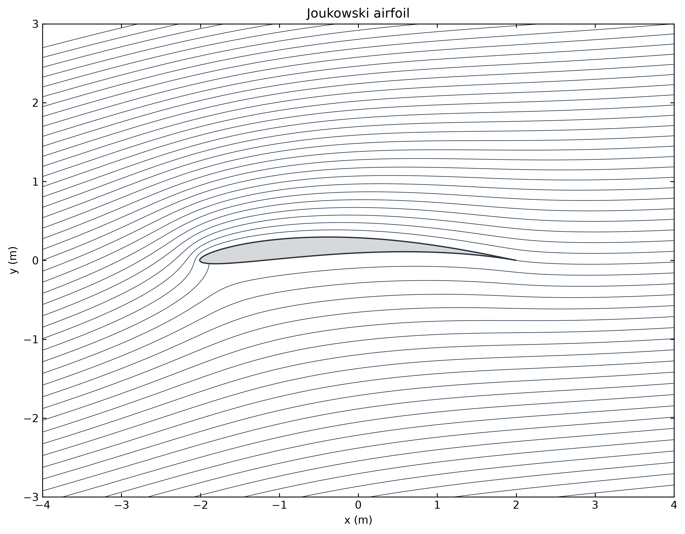
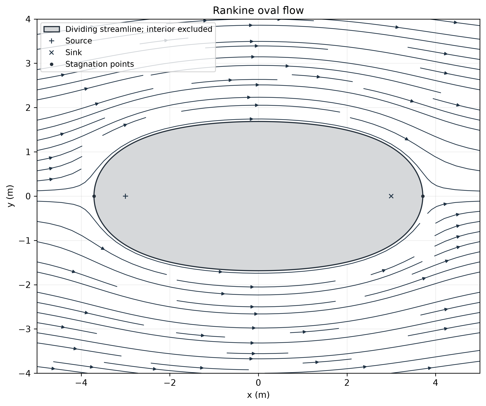
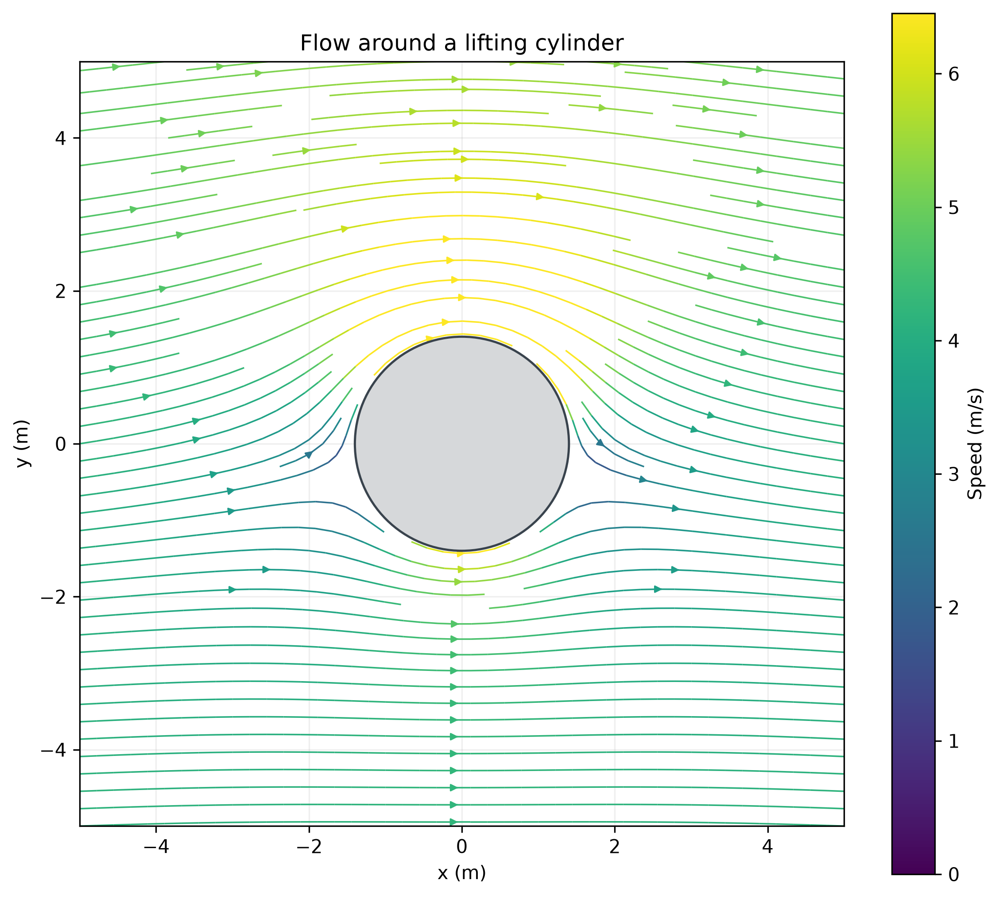
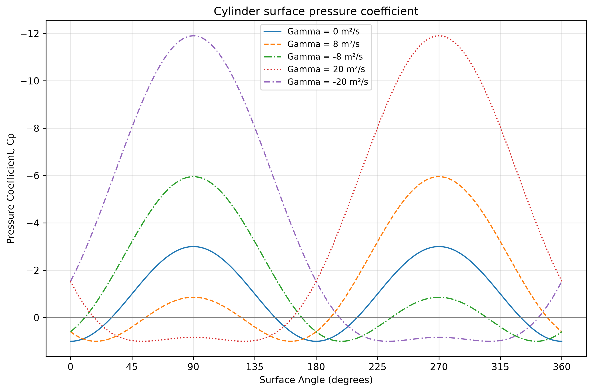
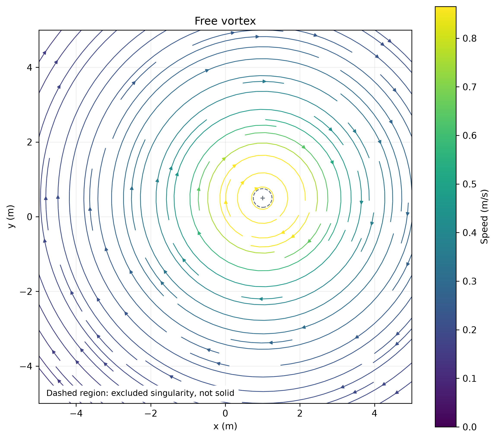
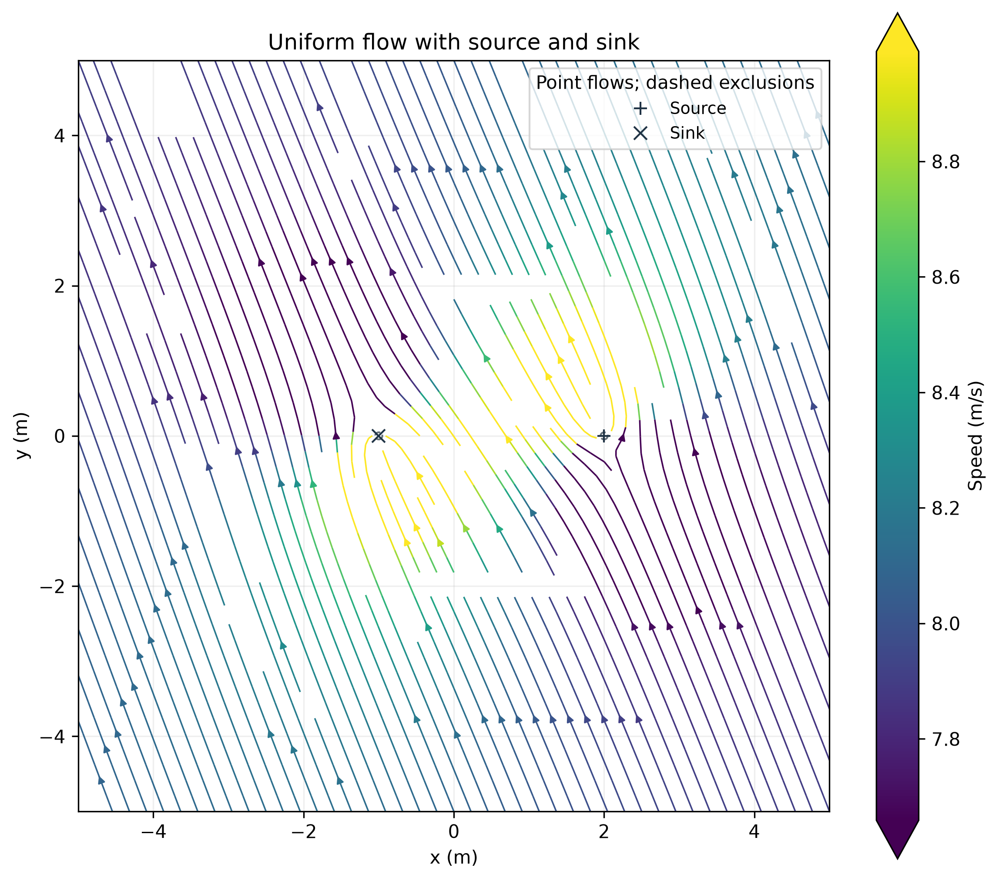

# 2D Potential Flow Visualization

**Python | NumPy | Matplotlib | Fluid Mechanics**

Analytical two-dimensional potential-flow solutions, evaluated on numerical grids, reveal how elementary flows combine into velocity fields, streamlines, circulation and pressure distributions. The examples keep the equations visible and separate field calculations from reusable plotting functions. This is an educational analytical visualization project, not a CFD solver.



*The Joukowski transformation maps flow around a circular cylinder into an idealized airfoil flow field.*

## Models and visualizations

The demonstrations cover uniform flow, point sources and sinks, superposition, a Rankine oval, uniform flow plus a doublet around a cylinder, a free vortex, a lifting cylinder, surface pressure coefficient and a Joukowski airfoil.

NumPy evaluates the analytical fields. Matplotlib displays velocity vectors, numerically traced streamlines, scalar contours and paired stream-function/equipotential contours. The airfoil example maps stream-function contours directly through a conformal transformation. These examples illustrate boundary conditions, circulation and pressure forces without discretizing and solving the governing flow equations.

## Featured examples

### Rankine oval



Uniform flow combined with an equal-strength source and sink produces a closed dividing streamline that can represent an idealized body boundary. The plus marks the source, the cross marks the sink, and the dots at the oval tips mark stagnation points, where velocity is zero. The dark outline is the dividing streamline; the gray interior is excluded from this exterior-flow visualization. A separate [geometry view](assets/rankine_oval.png) shows the boundary and point locations without the surrounding flow.

### Lifting cylinder



Adding circulation produces an asymmetric velocity distribution and a net lift force. Streamline colors indicate local speed; the gray circle identifies the solid cylinder.

### Cylinder pressure coefficient



Bernoulli's equation gives the surface pressure coefficient. Integrating this pressure distribution provides force per unit span, which can be compared with analytical lift. Negative pressure coefficients are plotted upward by engineering convention.

### Free vortex



Tangential speed varies inversely with distance from the center. Circulation around the singularity is nonzero even though local vorticity is zero outside it. The dashed central region is a numerical exclusion, not a solid body or a viscous core.

<details>
<summary>Additional example: source/sink superposition</summary>



An angled uniform stream combines with a point source and sink to change the local direction and speed. Dashed circles identify grid-sized exclusions around the singularities.

</details>

## Getting started

Use Python 3 with **NumPy 2.0 or newer** and Matplotlib. The pressure-integration example uses `np.trapezoid`, introduced in NumPy 2.0. The checked environment is Python **3.14.7**, NumPy **2.5.3** and Matplotlib **3.11.2**; other version combinations have not been verified here.

From the repository root, using a Python environment of your choice:

```sh
python -m pip install "numpy>=2.0" matplotlib
python joukowski_airfoil.py
```

Alternatively, install the declared dependencies with `python -m pip install -r requirements.txt`. Scripts import the adjacent `fluid_plots.py` directly; no package installation is needed for that module. Matplotlib opens figure windows; close each window to advance through examples with several figures. Demonstrations execute when run or imported and do not save figures by default.

A minimal call using precomputed arrays:

```python
import numpy as np
from fluid_plots import plot_streamlines

x = np.linspace(-2, 2, 81)
X, Y = np.meshgrid(x, x)
u = np.full_like(X, 2.0)  # m/s
v = np.zeros_like(Y)
fig, ax = plot_streamlines(
    X, Y, u, v, title="Uniform flow",
    color="#203345", linewidth=0.85,
    xlabel="x (m)", ylabel="y (m)",
)
```

Single-color streamlines suit uniform speed: a colorbar would add no spatial information.

## Shared plotting interface

[fluid_plots.py](fluid_plots.py) has five public functions:

| Function | Purpose |
| --- | --- |
| `plot_field()` | Filled scalar contours; optional additional 3D surface panel |
| `plot_vector()` | Quiver vectors with downsampling and optional speed coloring |
| `plot_streamlines()` | Numerically traced velocity streamlines, single-color or speed-colored |
| `plot_combined()` | Stream-function and velocity-potential contours on one axis |
| `source_or_sink()` | Evaluate a point source/sink; return `(psi, phi, ur, ux, uy)` |

The four plotting functions accept matching, precomputed 2D NumPy arrays and return a figure and axis (two axes for `plot_field(surface=True)`). Streamplots require an increasing, equally spaced rectangular meshgrid. The demonstration scripts calculate the physics; the plotters display supplied fields. Labels, prepared axes and optional 300 DPI saving are supported.

Speed colors normally span zero to the 95th percentile of the full finite, unmasked field, including before vector downsampling. Larger speeds share the endpoint color without numerical clipping. The source/sink streamline example alone uses a local P10-P95 interval, approximately **7.659-8.990 m/s** on its current grid; its colorbar extensions identify both saturated tails. Constant-color plots omit speed colorbars. See the [asset report](docs/phase4a_assets.md) for export-specific settings, including the exterior-only Rankine view.

## Analytical approach

Away from singularities, the potential-flow models are incompressible and irrotational. The repository uses the convention

$$
u=\frac{\partial\phi}{\partial x}=\frac{\partial\psi}{\partial y},
\qquad
v=\frac{\partial\phi}{\partial y}=-\frac{\partial\psi}{\partial x}.
$$

Here $\phi$ is velocity potential and $\psi$ is stream function. Superposition combines elementary solutions; solid boundaries satisfy no penetration. For the Rankine oval, a constant-$\psi$ dividing streamline defines the equivalent boundary.

Positive source strength denotes outward flow. Positive circulation $\Gamma$ is counterclockwise, with source strength and circulation in $\mathrm{m^2/s}$. For a cylinder of radius $R$ in a freestream along $+x$,

$$
V_\theta(R,\theta)=-2U\sin\theta+\frac{\Gamma}{2\pi R},
\qquad
C_p=\frac{p-p_\infty}{\tfrac12\rho U^2}=1-\left(\frac{V_\theta}{U}\right)^2,
\qquad
L_y'=-\rho U\Gamma.
$$

$L_y'$ is signed lift per unit span in $\mathrm{N/m}$. This sign matches the pressure integration: counterclockwise circulation gives downward lift for flow along $+x$.

The Joukowski map $\zeta=z+a^2/z$ transforms the exterior of an offset circle into an airfoil domain. The complex potential combines uniform flow, a doublet and circulation. Choosing $\Gamma=4\pi RU\sin(\theta_{te}-\alpha)$ enforces the Kutta condition at the circle point mapped to the trailing edge. It cancels the velocity numerator where the mapping derivative vanishes, giving a finite mapped limit. The current demonstration plots mapped streamlines; it does **not** calculate airfoil pressure or lift.

## Numerical validation

[Phase 2 validation](docs/phase2_validation.md) evaluated **225 parameter/check cases** across the active models. No active physics-equation error was found within the tested ranges. Checks compared numerical derivatives with analytical velocities, continuity and irrotationality away from singularities, source flux, vortex circulation, Rankine stagnation points, cylinder boundary conditions, pressure-integrated forces and Joukowski transformed velocities/trailing-edge behavior.

Representative results include a maximum cylinder force discrepancy of **1.705e-13 N/m** and a mapped Joukowski velocity derivative discrepancy of **1.268e-10 m/s**. Smooth-field derivative errors decreased approximately with grid spacing squared. These results depend on the stated parameters, exclusion regions and numerical checks; the near-exact cylinder force result reflects smooth periodic integrands rather than general pressure-integration accuracy.

The investigation also identified a thin-oval branch-cut plotting failure. [Phase 3A](docs/phase3a_review.md) corrected it using a grid-aware cut mask and resolution checks, with equations unchanged. The full report records tested ranges, convergence and remaining qualifications; this is not a claim of universal accuracy or a packaged automated test suite.

## Limitations

**Physical model:** These are two-dimensional, inviscid, locally irrotational models with idealized geometries. They cannot predict viscous boundary layers, separation, real aerodynamic drag or stall. The imposed Kutta condition selects a trailing-edge solution; it does not simulate viscosity. Point sources, sinks and vortices remain mathematical singularities.

**Numerical visualization:** Masks exclude unresolved samples without regularizing the equations. Branch cuts require special contour treatment, and thin Rankine geometries require sufficient grid resolution. Streamline tracing can leave gaps; percentile colors saturate extreme speeds, and yellow viridis lines have weaker contrast on white. Sampled geometry and contour interpolation limit trailing-edge detail. A shaded Rankine interior is a visualization exclusion, not a new physical solution.

## Source files and documentation

| Demonstration | What it calculates |
| --- | --- |
| [uniform.py](uniform.py) | Angled uniform velocity, stream function and potential |
| [uniform_source_sink.py](uniform_source_sink.py) | Angled uniform flow superposed with a point source and sink |
| [rankine.py](rankine.py) | Rankine oval flow, analytical stagnation points and dividing streamline |
| [cylinder_flow.py](cylinder_flow.py) | Uniform flow plus a doublet around a nonlifting cylinder |
| [vortex.py](vortex.py) | Free-vortex fields and a finite-difference vorticity diagnostic |
| [lift_cyl.py](lift_cyl.py) | Circulating-cylinder velocity, pressure coefficient and analytical lift |
| [cyl_pressure_plot.py](cyl_pressure_plot.py) | Cylinder surface pressure and integrated lift/drag for several circulations |
| [joukowski_airfoil.py](joukowski_airfoil.py) | Original-circle and transformed-airfoil stream-function contours |

`fun.py` and `test.py` are retained rotational-flow experiments, not finished potential-flow features; `test.py` is not a test suite.

- [Repository audit](docs/phase1_audit.md)
- [Mathematical validation](docs/phase2_validation.md)
- [Plotting corrections](docs/phase3a_review.md)
- [Final styles and local color normalization](docs/phase3c_review.md)
- [Featured assets and export verification](docs/phase4a_assets.md)

High-resolution public-facing figures are in `assets/`. Local comparison figures and export runners are under ignored `figures/` and are not included in a fresh checkout.
